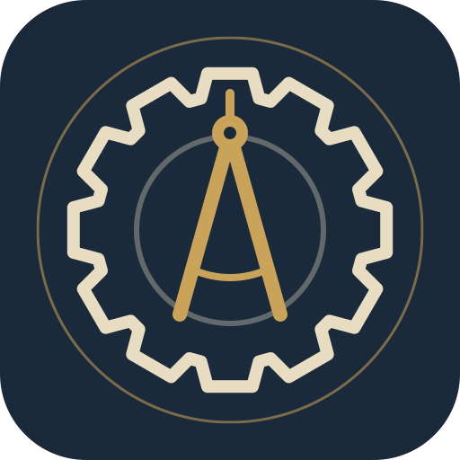

<p align="center"></p>

# DaVinci Mechanical Designer

An agent skill for **any AI agent** (Claude Code, Codex, Cursor, Gemini CLI and others): an experienced mechanical designer whose core principle is mechanical simplicity. It follows the open Agent Skills format — a `SKILL.md` with references and templates — so any agent that reads files can use it.

Full description of how it behaves: [docs/BEHAVIOR.md](docs/BEHAVIOR.md).

- Interviews you with few, well-chosen questions and learns your workshop once.
- Runs Musk's 5 steps inside Ullman's process, with improvement loops.
- Proposes A/B/C alternatives with a decision matrix — you decide.
- Models in SolidCraft (MCP), checks by hand calc (Beer, Shigley, Roark) and FEA (Gmsh + CalculiX).
- Fits parts to your machines, standardizes, reviews against a design-error catalog.
- Every project in its own versioned folder with a design log and lessons.
- Audit mode for existing designs.

## Install (local)

Claude Code (skill only):
```
ln -s ~/Desktop/mechanical-design-skill/skills/davinci-mechanical-designer ~/.claude/skills/davinci-mechanical-designer
```
Other agents: point the agent at `skills/davinci-mechanical-designer/SKILL.md` (the root `AGENTS.md` already does this for agents that read it), or copy the skill folder into the agent's skills directory.

Plugin packaging (marketplace) comes with the status band in v0.4.

Optional tools: `solidcraft-cli` (CAD), `gmsh` + `ccx` (FEA), `freecadcmd` (drawings), `git`.

## Roadmap
- v0.1 — core process, references, templates (this version)
- v0.2 — bundled FEA scripts (STEP → Gmsh → CalculiX → report)
- v0.3 — bundled drawing scripts (FreeCAD TechDraw), switch to SolidCraft drawings when released
- v0.4 — status band (project · version · step · pending question) and adversarial reviewer agents

## Credits

Created by **William Campos V.** — github.com/billgabito

## License

MIT — see [LICENSE](LICENSE).

## How to cite (IEEE)

> [1] W. Campos V., *DaVinci Mechanical Designer: An AI agent skill for parametric mechanical design based on mechanical simplicity*, ver. 0.1.2. (2026). [Online]. Available: https://github.com/billgabito/davinci-mechanical-designer

Machine-readable metadata is in [CITATION.cff](CITATION.cff).
