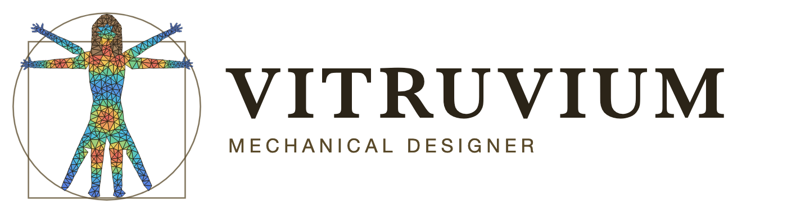

<p align="center"></p>

# Vitruvium

*Named after Vitruvius, the Roman engineer-architect of strength, utility and beauty. Visual identity: [brand/BRAND.md](brand/BRAND.md).*

An agent skill for **any AI agent** (Claude Code, Codex, Cursor, Gemini CLI and others): an experienced mechanical designer whose core principle is mechanical simplicity. It is an essential, end-to-end tool for creating mechanical parts from the first idea to the finished, manufacturable part (requirements, concept, parametric model, analysis, drawings and fabrication). It follows the open Agent Skills format — a `SKILL.md` with references and templates — so any agent that reads files can use it.

Full description of how it behaves: [docs/BEHAVIOR.md](docs/BEHAVIOR.md).

- Interviews you with few, well-chosen questions and learns your workshop once.
- Checks first whether the problem is already solved on the market — buy, adapt or design from scratch.
- Runs Musk's 5 steps inside Ullman's process, with improvement loops.
- Proposes A/B/C alternatives with a decision matrix — you decide.
- Models in SolidCraft (MCP), checks by hand calc (Beer, Shigley, Roark) and FEA (Gmsh + CalculiX).
- Fits parts to your machines, standardizes, reviews against a design-error catalog.
- Every project in its own versioned folder with a design log and lessons.
- An interactive 3D viewer per project: rotate, section, systems on/off, stress overlay, animation of moving parts and the full version history.
- An independent auditor approves every iteration before it is shown to the user.
- Audit mode for existing designs.

## Install

Install it as a Git clone so it can update itself:
```
git clone https://github.com/billgabito/vitruvium.git ~/vitruvium
```
Claude Code:
```
ln -s ~/vitruvium/skills/vitruvium ~/.claude/skills/vitruvium
```
Other agents: point the agent at `skills/vitruvium/SKILL.md` (the root `AGENTS.md` already does this for agents that read it), or link the skill folder into the agent's skills directory. Copying the folder works too, but then it cannot update itself.

## Updates

Vitruvium checks for a new release at most once a day, when it is used. It asks before updating; if you choose "always update automatically" it updates without asking from then on. Your workshop profile, lessons and projects live outside the skill folder (`~/.vitruvium/`, your projects folder), so updates never touch them. Manual control:
```
sh ~/vitruvium/skills/vitruvium/scripts/update.sh check --force   # look now
sh ~/vitruvium/skills/vitruvium/scripts/update.sh mode ask         # ask | auto | off
```

Plugin packaging (marketplace) comes with the status band in v0.4.

Optional tools: `solidcraft-cli` (CAD), `gmsh` + `ccx` (FEA), `freecadcmd` (drawings), `git`. Check what you have with `sh skills/vitruvium/scripts/check_tools.sh`; verified download links and install commands for every OS are in [tools-setup.md](skills/vitruvium/references/tools-setup.md).

## Roadmap

Done (see [CHANGELOG.md](CHANGELOG.md)): core process, existing-solutions search, IP rating, tool setup, self-update, FEA script, iteration log, live 3D viewer (v0.8.0).

Next:
- Drawing script (FreeCAD TechDraw from STEP); switch to SolidCraft drawings when released
- Filled section caps in the viewer
- Status band (project · version · step · pending question) and adversarial reviewer agents
- First real project to validate the whole flow with SolidCraft exports

## Credits

Created by **William Campos V.** — github.com/billgabito

## License

MIT — see [LICENSE](LICENSE).

## How to cite (IEEE)

> [1] W. Campos V., *Vitruvium: An AI agent skill for parametric mechanical design based on mechanical simplicity*, ver. 0.9.0. (2026). [Online]. Available: https://github.com/billgabito/vitruvium

Machine-readable metadata is in [CITATION.cff](CITATION.cff).
