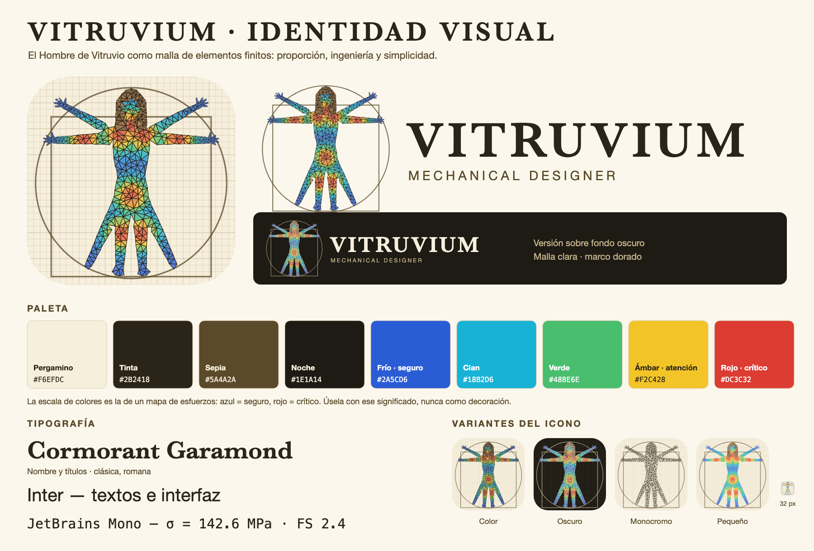

# Vitruvium — visual identity

*Version 1.1 · 2026-11-15*

## Concept

Vitruvius' man drawn as a **finite-element mesh, coloured like a stress map**. The figure keeps the classic details — long hair (in sepia tones, outside the stress scale) and open hands with five fingers — and the hot zones sit where loads really concentrate: shoulders, hips and knees. Mesh lines are fine (thinner on small triangles) so colour and silhouette lead. It joins the three ideas behind the skill:
- **proportion and classical design**: Vitruvius, the Roman engineer-architect of *firmitas, utilitas, venustas* (strength, utility, beauty), and Leonardo's drawing;
- **engineering analysis**: the mesh and the stress colours;
- **simplicity**: one figure, one frame, nothing added.

## Assets

| File | Use |
|---|---|
| `icon.svg` / `icon.png` | Main icon (parchment, coloured mesh) |
| `icon-dark.svg` / `.png` | Icon on dark backgrounds |
| `icon-mono.svg` / `.png` | One-colour use: print, engraving, stamps |
| `icon-small.svg` / `.png`, `icon-small-64.png` | 16–48 px: favicons, tabs, small UI (no mesh lines) |
| `mark.svg`, `mark-light.svg` | Symbol without background, to combine with text |
| `logo.svg` / `.png`, `logo-dark.svg` / `.png` | Horizontal logo: symbol + VITRUVIUM + MECHANICAL DESIGNER |
| `brand-board.svg` / `.png` | This summary sheet |

Regenerate everything: `python3 generate.py && python3 board.py` (PNG rendering uses headless Google Chrome).

## Colour

| Name | Hex | Role |
|---|---|---|
| Pergamino (parchment) | `#F6EFDC` | Main background |
| Tinta (ink) | `#2B2418` | Text, lines, mesh |
| Sepia | `#5A4A2A` | Frames, secondary text |
| Noche (night) | `#1E1A14` | Dark background |
| Frío · seguro (cold · safe) | `#2A5CD6` | Stress scale — low |
| Cian | `#18B2D6` | Stress scale |
| Verde | `#48BE6E` | Stress scale |
| Ámbar · atención | `#F2C428` | Stress scale — warning |
| Rojo · crítico | `#DC3C32` | Stress scale — critical |

The five stress colours keep their engineering meaning everywhere — blue is safe, red is critical. Use them for status (safety factor OK / warning / failing), never as decoration.

## Typography

- **Cormorant Garamond** (SemiBold, wide tracking, capitals) — the name and titles. Classical, Roman.
- **Inter** — body text and interfaces.
- **JetBrains Mono** — numbers, units, results (`σ = 142.6 MPa · FS 2.4`).

All three are free (Google Fonts / SIL Open Font License). Fallbacks: Baskerville/Georgia, Helvetica Neue/Arial, Menlo.

## Rules

- Clear space around the logo: at least the height of the figure's head on every side.
- Minimum sizes: main icon 48 px; below that use `icon-small`. Horizontal logo at least 160 px wide.
- Do not stretch, rotate, recolour the mesh arbitrarily, add shadows or glows, or place the coloured icon on a busy photo.
- On dark backgrounds use the dark variants; on one-colour media use `icon-mono`.

## Voice

Like the skill itself: an experienced engineer — direct, honest, plain words, numbers with units and sources, always an alternative instead of a flat "no".
